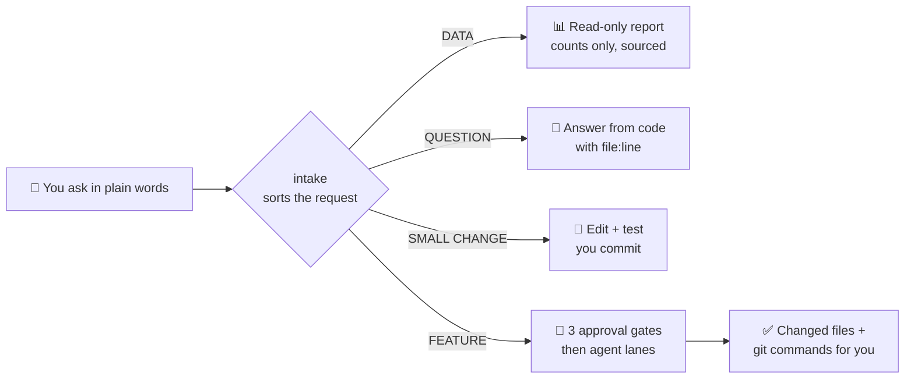
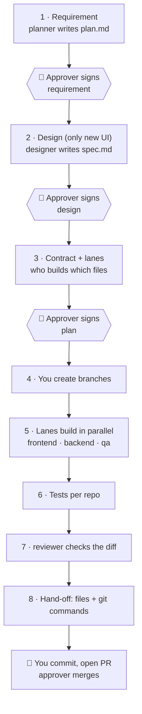

# Claude Agent Workspace

**One folder for all your repos. Ask Claude in plain words. A team of AI agents does the work. A human approves every big step.**

You open [Claude Code](https://docs.claude.com/en/docs/claude-code) in one folder that links all your team's repos.
You type what you need: *"How many orders did we get last week?"* or *"Add a CSV export to the orders page."*
Claude finds the right repo and API, plans the work, and splits it between specialist agents (planner, designer,
frontend, backend, QA, reviewer). It stops at three gates until your approver signs them. It never commits, pushes
or merges. Your team does that.

Rules are enforced by **hooks** (small scripts that run before every tool call), not by trust.

> 📖 **Visual runbook:** [docs/RUNBOOK.md](docs/RUNBOOK.md) shows every flow as a diagram.

---

## Who is this for?

- Teams with **several repos** (web, API, mobile, admin) that want one place to work with Claude.
- Teams that want AI help **without losing control**: a named person approves, and people own git.
- Anyone who wants a **ready structure** for agents, skills and hooks instead of building one from zero.

It works with any stack. The scripts understand Node (Next.js, React, Express, NestJS), Laravel/PHP and Python repos.

---

## How it works in 30 seconds



---

## What you get

| Part | What it does |
|---|---|
| `CLAUDE.md` | The rules Claude reads every session: routing, gates, data rules, "follow the existing code". |
| `workspace.md` | Your map: products → repos → APIs, the approver, themes, test commands. |
| `.claude/skills/` | **intake** (sorts every request), **data** (safe reports), **feature** (the gated flow) + templates. |
| `.claude/agents/` | Six agents: planner, designer, frontend, backend, qa, reviewer. Each has one job. |
| `.claude/hooks/` | Guards: no lanes before approval, no self-approval, no secrets, no API writes, no git writes. |
| `.claude/settings.json` | Allow / ask / deny lists that back up the hooks. |
| `bin/` | `approve` (human signs a gate), `scan-repos.js`, `api-scan.js`, `api-get.js` (GET only), `data-count.js`, `dev` (run apps and tests), `test-hooks.sh` (proves the guards work). |
| `examples/` | A full sample feature (plan, approval, contract, lane brief) and a sample data report. |

---

## Before you start

You need:

1. **Claude Code** installed and logged in. ([install guide](https://docs.claude.com/en/docs/claude-code/setup))
2. **Node.js 20+** and **jq** (`brew install jq` on macOS, `sudo apt install jq` on Ubuntu, `winget install jqlang.jq` on Windows).
3. **Git**, with your name set: `git config --global user.name "Your Name"`.
4. **Docker Desktop** (optional). Only for `bin/dev`. Without it, run your apps the normal way (see Step 6).

Optional, only if you use them:
- **Figma MCP**: lets the designer agent read Figma links. Without it, give an image or say "use the existing UI".
- **Playwright** in your web repos: the QA agent writes browser tests with it. Without it, QA uses your repo's own test tool.
- **A tracker MCP** (Shortcut, Jira, Linear, GitHub): only if you want tickets updated.

> Windows: use **WSL** (Ubuntu). The hooks are Bash scripts.

---

## Setup, step by step

### Step 1. Get the kit
```bash
git clone https://github.com/<you>/claude-agent-workspace.git ~/work
cd ~/work
chmod +x bin/approve bin/dev bin/test-hooks.sh .claude/hooks/*.sh   # make the scripts runnable
```

### Step 2. Link your repos
Your repos stay where they are. You only add a link (a shortcut) inside `~/work`:
```bash
ln -s ~/code/shop-web  ~/work/shop-web
ln -s ~/code/shop-api  ~/work/shop-api
```
Claude only sees the repos you link. The `.gitignore` keeps these links out of git.

### Step 3. Set the approver
Open `workspace.md` and change the `Approver:` line to the **exact** git name of the person who approves work:
```bash
git config --global user.name     # run this on the approver's laptop and copy the result
```
Only that person can sign gates.

### Step 4. Fill in your map
In `workspace.md`, replace the example rows with your products, repos, APIs, test commands and theme files.
Then let the scripts fill the rest:
```bash
node bin/scan-repos.js     # writes the repo table (stack, scripts, branch) into workspace.md
node bin/api-scan.js       # writes apis/<repo>.md: every endpoint each repo calls or serves
```
Run them again when repos or routes change.

### Step 5. (Optional) Connect read-only data
For data questions, Claude needs a **read-only** source:
- **Best:** a read-only database MCP connector. In Claude, type `/mcp`, pick it, log in.
- **Or:** API tokens for GET requests:
  ```bash
  cp .secrets/tokens.env.example .secrets/tokens.env
  ```
  Fill it with **read-only** tokens. Never paste tokens into the chat. Claude cannot read `.secrets/`; `bin/api-get.js` loads it itself.

### Step 6. (Optional) Run your apps in Docker
```bash
cp docker/compose.example.yml docker/compose.yml   # add one service per repo
bin/dev up            # start everything
bin/dev test shop-api # run one repo's tests
bin/dev down          # stop
```

**No Docker? That's fine.** Docker is only a convenience. Skip Step 6 and run each repo the normal way:
```bash
cd ~/work/shop-web && npm install && npm run dev      # a Node app
cd ~/work/shop-api && php artisan serve               # a Laravel app
```
Then write each repo's own test command in the **Test commands** table of `workspace.md`
(for example `npm test` or `php artisan test`) and set **Runs in** to `native`.
`bin/dev test <repo>` reads that table and runs the command in the repo folder (`native`) or in its container
(`docker`). Try it safely with `DRY_RUN=1 bin/dev test <repo>`: it prints the command and runs nothing. Everything else (intake, gates, agents,
hooks, data reports) works the same without Docker.

### Step 7. Protect your main branch
On GitHub, turn on **branch protection** for `main` in every repo: merge only with a reviewed pull request.
The hooks run on each laptop; branch protection is the real lock.

### Step 8. Check the guards work
```bash
bash bin/test-hooks.sh
```
Every line should say `ok`. If one says `FAIL`, fix it before you start (usually `jq` is missing).

### Step 9. Start
```bash
cd ~/work && claude
```
Type your request. The first line of every answer tells you how Claude understood it:
```
Type: FEATURE (L) — repo(s): shop-web, shop-api — new endpoint + new button.
```

---

## Your first requests

| You type | Claude does |
|---|---|
| "How many orders per status last month?" | **DATA**: pins the exact definition, runs an aggregate query, writes `docs/data/<date>-<slug>.md` marked UNVERIFIED. |
| "Where do we check if a user owns a shop?" | **QUESTION**: answers with `file:line`. No edits. |
| "Fix the typo on the checkout button" | **CHANGE S**: edits the file, runs the test, lists the changed files and the git commands. |
| "Add CSV export to the orders page" | **FEATURE**: asks up to 5 questions, then the gated flow below. |

You can write in any language. Claude answers in the same one.

---

## The feature flow



**How a gate works:**
1. Claude writes `docs/features/<name>/APPROVAL.md`: a short summary (max 40 lines) of what is being approved.
2. You send it to the approver.
3. The approver runs this **in their own terminal** (Claude is blocked from running it):
   ```bash
   bin/approve <feature> requirement     # later: design, plan
   ```
   It shows the summary, asks `y/N`, checks their git name, and adds a signature line to `plan.md`.
4. You tell Claude "requirement approved". It checks the signature and continues.

See a full example in [`examples/features/order-csv-export/`](examples/features/order-csv-export/).

---

## The agents

| Agent | Job | Never |
|---|---|---|
| **planner** | Finds the stack, asks gap questions, writes `plan.md` with testable acceptance criteria and a context map. | Writes app code. |
| **designer** | Turns Figma, an image or a URL into `spec.md`. With no design, builds a mockup in your existing look. | Invents a new style. |
| **frontend** | Builds the UI from plan, contract and spec. Tokens only, every state (loading, empty, error). | Adds packages or runs git. |
| **backend** | Builds one endpoint group exactly to the contract, with validation, server-side auth and tests. | Changes the contract alone. |
| **qa** | Writes Playwright tests from the acceptance criteria (not from the code) and runs them. | Edits app code. |
| **reviewer** | Read-only review of the diff against the plan and your repo rules. | Edits anything. |

Each lane edits **only inside its own repo** (`Repo: <dir>` is the first line of its brief).

---

## Safety rules (enforced)

| Guard | Blocks |
|---|---|
| `approval-gate.sh` | Starting frontend/backend/qa lanes before the approver signed `plan.md`. |
| `no-self-approve.sh` | Claude writing any signature line. |
| `bash-guard.sh` | POST/PUT/PATCH/DELETE to APIs · reading `.secrets/` or `.env` · running `bin/approve` · git commit/push/merge/switch. |
| `settings.json` | The same git writes, secrets, and editing the hooks or settings themselves. Tracker writes ask first. |

If `jq` is missing, every guard **blocks** (it fails closed) and tells you to install `jq`.

> **Be honest about what the gates are.** They stop *Claude* from skipping a step. They do not stop a *person*:
> `bin/approve` only checks the git name, and anyone can change their own git name or edit the hooks on their
> laptop. The gates are a team agreement that Claude cannot break. Your real security is GitHub branch protection
> and PR review (Step 7).

**Data rules:** live data is read-only. Chat shows counts only, never names, emails or phone numbers. Every number has a
source. Every report stays **UNVERIFIED** until the approver spot-checks 2–3 numbers in the real app.

---

## House rules every agent follows

1. **Follow the existing code.** Copy the closest existing file. Same libraries, same layer, same file style. Only optimisation may differ.
2. **Ask for the design.** No design given? Ask whether to reuse the current UI. Never invent a look.
3. **Say only what ran.** "Tested" names the exact check. On a failure, read the real error first.
4. **Infra before code.** Check the database, queue, env and deploy before changing code.
5. **A question is not an order.** "Why should we revert X?" gets reasons and a recommendation, not a revert.

---

## Built to save tokens

Only `CLAUDE.md` is loaded every session (about 1,500 tokens). Everything else loads only when that job runs.

| What | When it loads | About |
|---|---|---|
| `CLAUDE.md` | every session | 1,500 tokens |
| `intake` / `data` / `feature` skill | only for that kind of request | 550 / 550 / 1,000 |
| each agent file | only when that agent runs | 550–750 |
| `README.md`, `docs/RUNBOOK.md` | never (they are for people) | 0 |

Rules that keep the cost down:
- **Agents read a short list of files**, starting with their lane brief and the plan's context map, instead of exploring the repo.
- **API catalogs are grepped, never read whole.** A large backend's catalog can be 30k+ tokens.
- **Data questions use `COUNT … GROUP BY`**, not rows. 200 rows cost 10–20k tokens; a grouped answer costs a few hundred.
- **Questions are asked once**, in one numbered message with defaults, so there's no back-and-forth.
- **Lane reports are 15 lines max** and show failures only.
- **Stuck rule:** the same error twice → stop and report. No loops.
- **Limits on looking:** about 40 tool calls per frontend lane, 2 screenshot rounds per section, and 35 calls for the designer.
- **Design lookups are cached** in `design/figma/`. Other agents read the cache instead of calling Figma again.
- **Budget line** in `CLAUDE.md`: how many agents run at once (2 on Pro), a mid-size model by default, and one large feature at a time.
- **Near a usage limit**, Claude finishes the current wave and writes `resume.md`, so the next session picks up without re-reading everything.
- `docs/features/<name>/retro.md` lets you compare time and tokens with the last feature.

## Make it yours

- **Rules per repo:** add `<repo>/.claude/rules/*.md` (frontend, backend, design-tokens, qa). The planner fills missing ones from your real code.
- **Tracker:** the kit ships with Shortcut permissions as an example. For Jira, Linear or GitHub Issues, connect that MCP and change the `ask` list in `.claude/settings.json`. The ticket format is in `.claude/skills/feature/templates/ticket.md`.
- **Budget:** in `CLAUDE.md`, set how many agents may run at once (2 on Pro, 4 on Max).
- **New agent or skill:** add a file to `.claude/agents/` or a folder to `.claude/skills/`. Keep each one short; long rules get ignored.

---

## Folder map

```
work/
├── CLAUDE.md               rules for every session
├── workspace.md            your map: products, repos, APIs, approver, themes
├── .claude/
│   ├── agents/             planner, designer, frontend, backend, qa, reviewer
│   ├── skills/             intake, data, feature (+ templates)
│   ├── hooks/              approval-gate, no-self-approve, bash-guard
│   └── settings.json       allow / ask / deny + hook wiring
├── bin/                    approve, scan-repos, api-scan, api-get, data-count, dev
├── apis/                   generated endpoint lists (git-ignored)
├── docs/
│   ├── RUNBOOK.md          the visual runbook
│   ├── features/<name>/    plan, APPROVAL, contract, design, lanes (git-ignored)
│   └── data/               data reports (git-ignored)
├── docker/                 compose.example.yml
├── examples/               a full sample feature and data report
└── <your repos>            linked, git-ignored
```

---

## FAQ

**Claude says "Blocked by the approval gate".**
The lanes need signatures in `plan.md`. Ask the approver to run `bin/approve <feature> <gate>`.

**The approver gets "Only <name> can approve".**
Their `git config --global user.name` must match the `Approver:` line in `workspace.md` exactly.

**"Blocked by workspace rules: secrets…"**
Working as designed. Claude never reads `.secrets/` or `.env`. Use `node bin/api-get.js`, which loads tokens itself.

**Can someone just turn the hooks off, or pretend to be the approver?**
On their own laptop, yes: hooks and `bin/approve` run locally and trust the git name. They keep Claude in line,
not people. That is why Step 7 (branch protection) matters: nothing reaches `main` without a reviewed PR.

**Do I need `.claude/rules/` in my repos?**
No. Agents copy your existing code when there are no rules. The planner can write short rule files for you from
your real code the first time it plans a feature in that repo.

**Does this send my code anywhere new?**
No. It uses Claude Code as you already do. The scripts only read local files and make GET requests you configure.

**Does it work on Windows?**
Yes, through WSL.

**Do I need Docker?**
No. Docker only powers `bin/dev`. Run your apps with their own commands and put those test commands in
`workspace.md` with **Runs in: native**.

---

## Contributing

Ideas and fixes are welcome. See [CONTRIBUTING.md](CONTRIBUTING.md).

## License

MIT. See [LICENSE](LICENSE).
