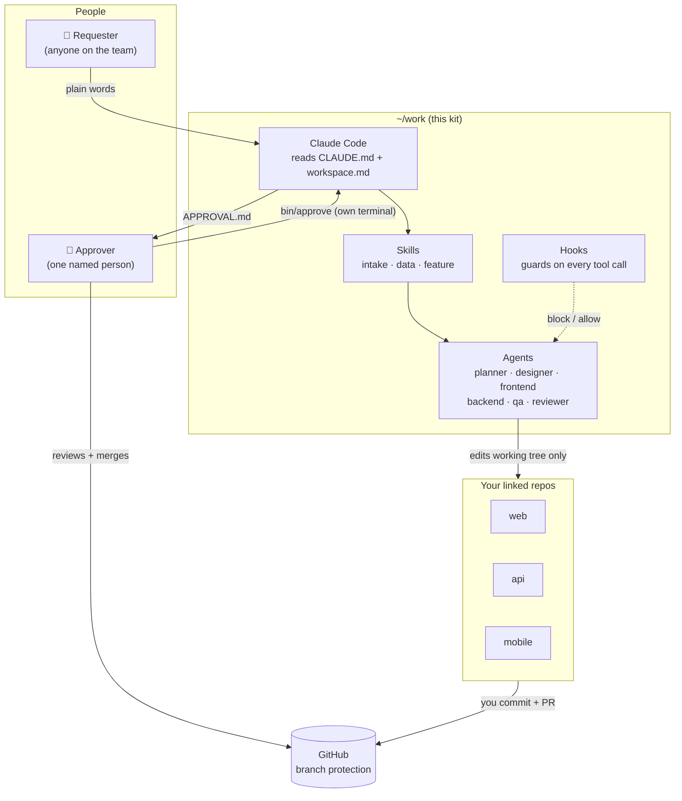
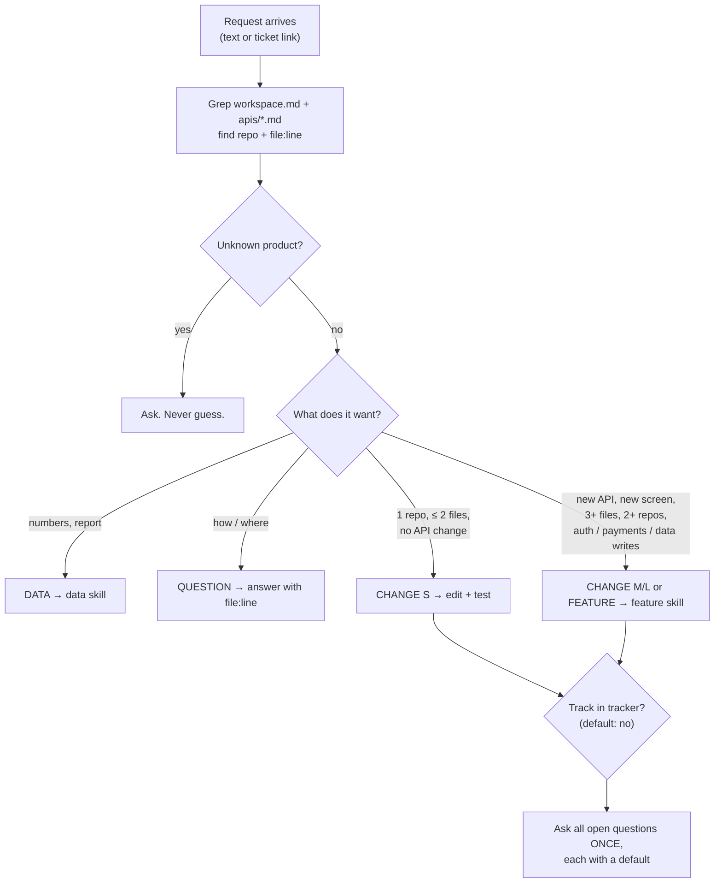
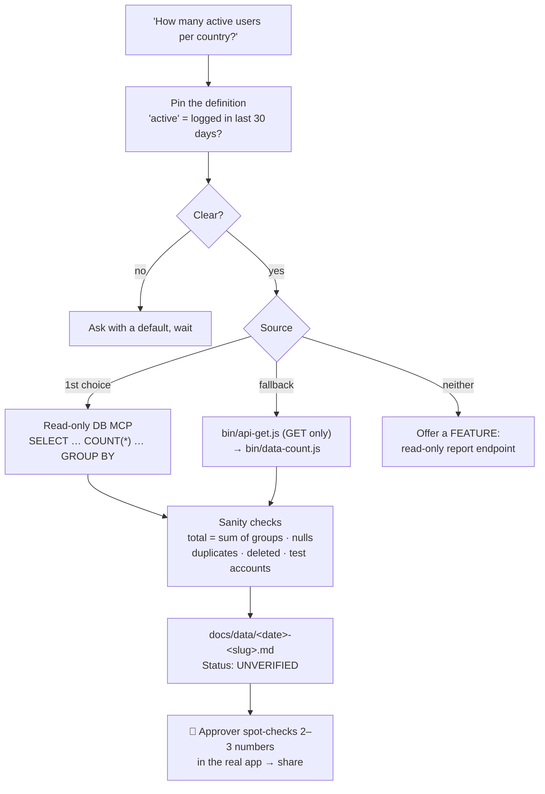
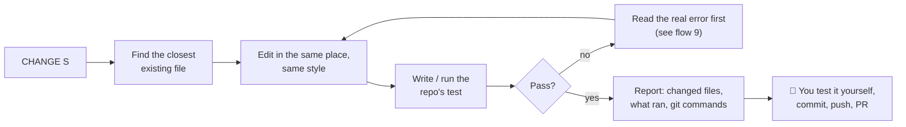
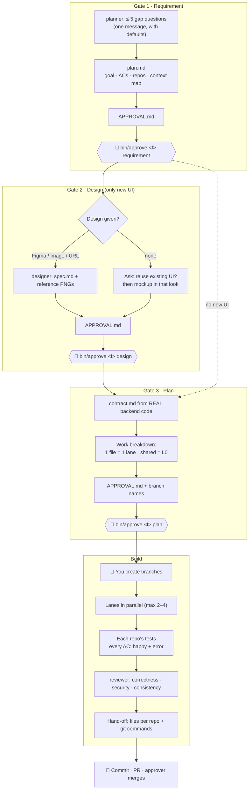
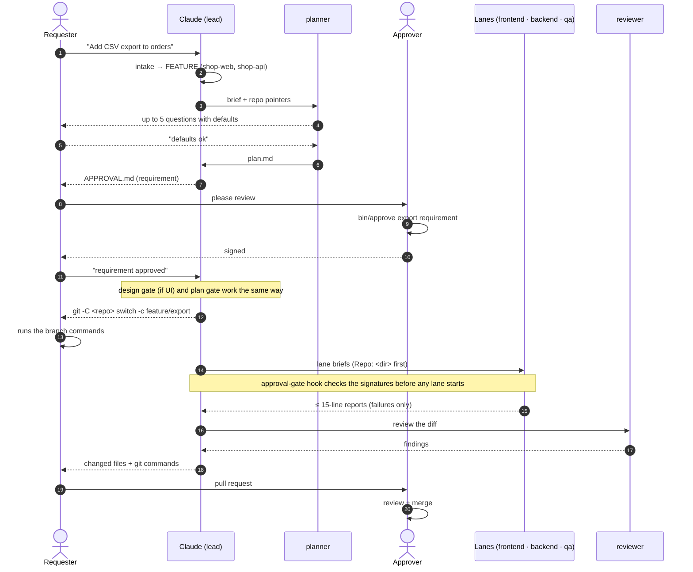
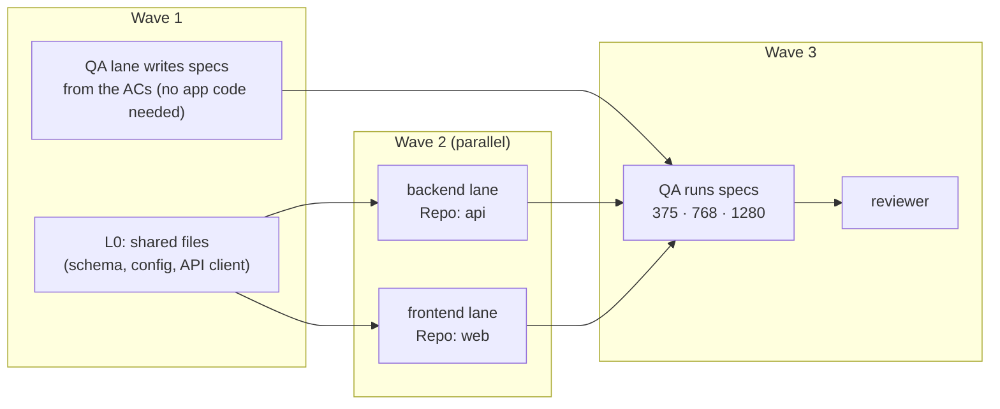
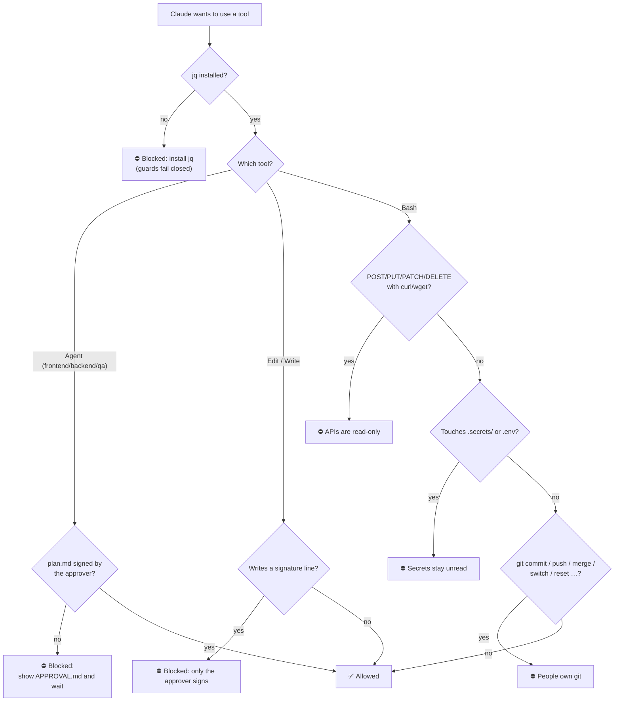
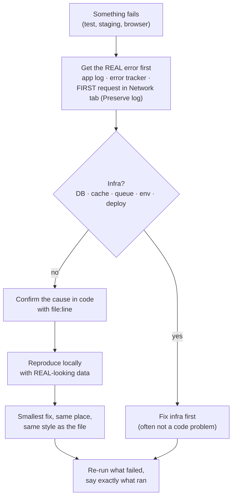
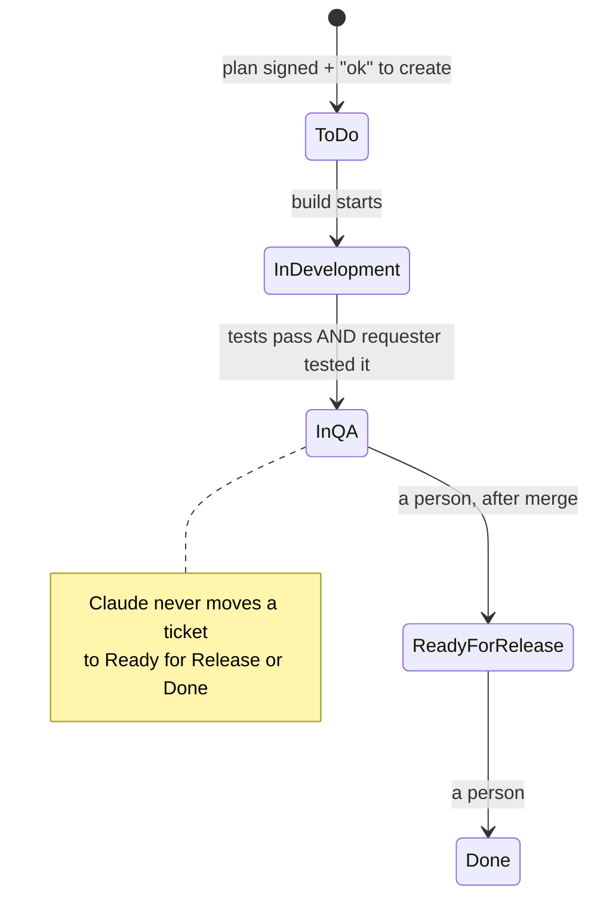

# Visual runbook

Every flow in this workspace as a picture. GitHub draws these diagrams for you.
Read top to bottom the first time; later, jump to the flow you need.

1. [The big picture](#1-the-big-picture)
2. [Intake: how a request is sorted](#2-intake-how-a-request-is-sorted)
3. [A data request](#3-a-data-request)
4. [A small change](#4-a-small-change)
5. [A feature, end to end](#5-a-feature-end-to-end)
6. [Who does what, and when (sequence)](#6-who-does-what-and-when)
7. [Lanes and waves](#7-lanes-and-waves)
8. [What the guards check on every tool call](#8-what-the-guards-check)
9. [When something fails](#9-when-something-fails)
10. [Ticket states](#10-ticket-states)

---

## 1. The big picture

---

## 2. Intake: how a request is sorted

The first line of every answer shows the result:
`Type: CHANGE (S) — repo(s): shop-web — one file, copy fix.`

---

## 3. A data request

Chat shows **counts only**. Raw rows stay in git-ignored files. Example: [`examples/data/`](../examples/data/).

---

## 4. A small change

---

## 5. A feature, end to end

A change to an approved AC, design or contract during the build stops the affected lanes and re-opens that gate.

---

## 6. Who does what, and when

---

## 7. Lanes and waves

- A lane edits **only** the files it owns. Needs a shared file → reports `NEEDS L0: <file> — <what>`.
- **Stuck rule:** the same error twice → stop and report. No third try.
- A lane report is at most 15 lines and shows failures only.

---

## 8. What the guards check

Plus the deny list in `.claude/settings.json`: Claude cannot edit the hooks or the settings themselves.
Prove it on your laptop with `bash bin/test-hooks.sh` (every line should say `ok`).

These guards keep **Claude** inside the rules. People can still change their own laptop, so GitHub branch
protection and PR review stay the real lock.

---

## 9. When something fails

Don't guess causes before reading the error. Don't change code until the cause is confirmed.

---

## 10. Ticket states

Only when the requester said "track this". Local-only work never touches the tracker.
